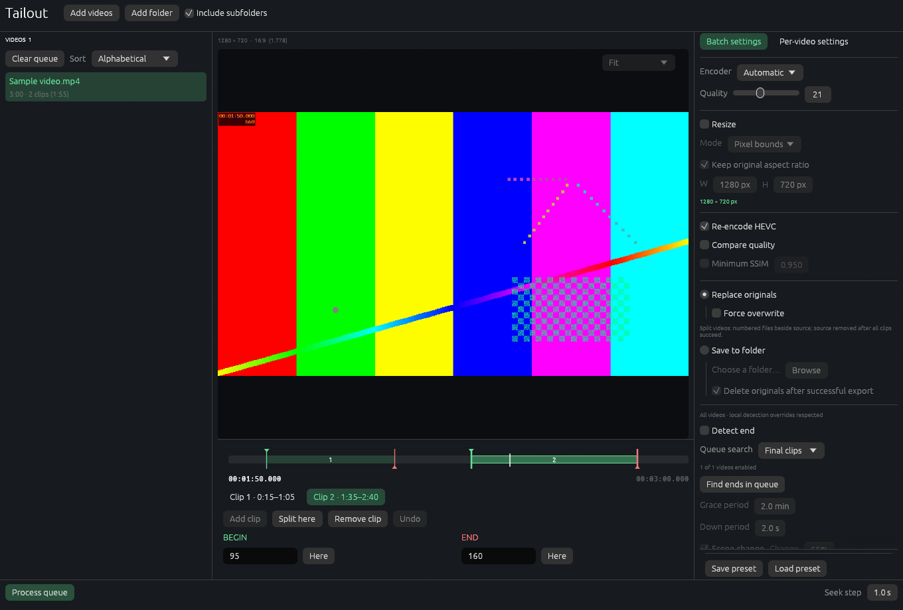

# Tailout

**Video Trimmer and HEVC Batch Converter**

> Maurits Lam<br/>
> 2026

<p align="center">
  
</p>

A Rust desktop application for trimming, shrinking and converting videos to HEVC,
using FFmpeg and FFprobe.

## Features

- **Trimming and splitting:** Keep multiple clips, discard gaps and export numbered files, with a live frame preview.
- **HEVC encoding:** Use NVIDIA NVENC or CPU encoding with x265.
- **Resizing:** Shrink by pixel dimensions or percentage, with optional aspect-ratio preservation.
- **Batch processing:** Queue videos, share settings, and override individual videos. Save and load presets.
- **End detection:** Find scene changes, black/solid-color screens, fullscreen exits, still pictures (allowing small animations), or a reference image's color histogram.

## Installation

Windows 10/11, 64-bit. Run the Windows installer, or build from source below.
Installation is per user and does not require administrator access.

Install [FFmpeg](https://ffmpeg.org/download.html) 6 or newer with `libx265`.
Both `ffmpeg.exe` and `ffprobe.exe` must be on `PATH` or beside `tailout.exe`;
they are not bundled. NVIDIA encoding additionally requires a compatible GPU and driver.

## Usage

1. Click **Add videos** or **Add folder**, then select a video in the queue.
2. Set **Begin** and **End** by entering times, dragging markers, or clicking **Here**. Use **Split here** to divide a clip, **Add clip** in a discarded gap, and **Remove clip** or **Undo** to adjust the selection. Numbered green timeline bands show kept clips; click a band or clip chip to edit it.
3. Configure encoding and resize options in **Batch settings**. Changes in **Per-video settings** override that video's defaults; **Reset to batch settings** restores them.
4. Optionally enable **Detect end** for a clip and click **Find end**. **Find ends in queue** searches final clips by default; choose **All enabled clips** to include internal clips. Detection starts after each clip's begin plus the grace period (two minutes by default), with a two-second down period. Manual end changes override detection.
5. Choose the output mode and click **Process queue**. Right-click a video to process it individually.

Multiple clips export as `video-1.hevc.mp4`, `video-2.hevc.mp4`, etc., in timeline order. Existing filenames are preserved. Video presets include every clip; batch presets exclude markers.

**Replace originals** is the default and creates no backups. Split exports create
numbered files beside the source and remove it only after every clip succeeds.
Cancellation or partial failure keeps the source and completed clip files. **Save to folder**
also deletes originals after successful export by default; uncheck **Delete originals
after successful export** to keep them.

Use **Left/Right** or the mouse wheel to seek; **I/O** set the begin/end markers.
The preview shows frames without audio playback.

**Still picture** tolerates small animated regions (2% by default) and compression
noise. Tighten its tolerances or disable it for videos containing intentional
static shots; it can match those too.

## Building

Requires Rust 1.95 or newer. On Windows, install the MSVC C++ Build Tools and Windows SDK.

```powershell
cargo run --release
```

To create the Windows installer, install [Inno Setup](https://jrsoftware.org/isinfo.php)
6.3 or newer and run from PowerShell 7:

```powershell
./installer/build-installer.ps1
```

The installer is written to `dist/`.

## Testing

See the [end-detection corpus](tests/fixtures/detection/README.md) for small public
samples, accuracy checks and reproducible performance measurements.

## Support

Report bugs and request features through [GitHub Issues](https://github.com/mhjlam/Tailout/issues).
